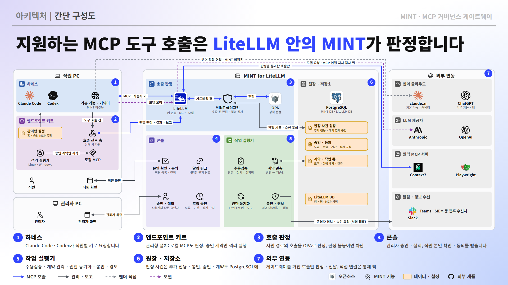

# MINT for LiteLLM

LiteLLM 프록시에 플러그인으로 붙어 MCP 서버와 도구 호출에 거버넌스를 더하는 Python 패키지입니다.



- 도입 수용검증 → 승인 → 호출 판정 → 변경 재승인 → 종료 판정 → 원장
- LiteLLM의 인증·전송·자격 저장·속도 제한은 그대로 쓰고, 그 위에 승인과 정책 판정을 더합니다.
- 판정 불능이면 차단합니다(fail-closed). 허용 판정을 원장에 먼저 기록하지 못해도 차단합니다.
- 판정은 LiteLLM 훅을 지나는 도구 호출에만 성립합니다. 게이트웨이를 거치지 않는 직접 연결과 집행하지 않는 경로(`prompts`·`resources` 등)는 [보장과 한계](docs/보장과-한계.md)에 모읍니다.

## 구성

| 구성요소 | 실행 위치 | 하는 일 |
| --- | --- | --- |
| 플러그인(가드레일) | `litellm` | LiteLLM 훅(`pre_call`·`pre_mcp_call`·`post_mcp_call`)에서 도구 목록과 호출을 판정하고 결과를 검사하며 판정 사건을 기록합니다. 지원하는 모델 요청 본문의 MCP 연결 지시도 막습니다. |
| 결정 경로 | `litellm` | 단말 훅이 부르는 `/mint/v1/decide`·`/mint/v1/result`·`/mint/v1/endpoint/report`. 플러그인과 같은 판정 순서를 씁니다. |
| 정책 엔진 | `opa` | 활성화된 정책 번들(Rego)로 판정합니다. 정책별 집행 위치와 분류는 `policy/catalog.json`에 있습니다. |
| 저장소 | `postgres` | MINT DB(승인·동의·판정 사건·계약·작업 큐)와 LiteLLM DB를 따로 둡니다. 판정 사건 원장은 추가만 하고 작업 실행기가 주기적으로 해시 연쇄로 봉인합니다. |
| 작업 실행기 | `worker` | 수용검증, 계약 관측과 재승인, LiteLLM 권한 동기화, 승인 만료·재확인, 호출 급증·대량 추출·취약점 점검, 봉인·서명 내보내기, 경보와 웹훅 전송을 맡습니다. |
| 관리자 콘솔 | `console` | 관리자 화면(신청·승인·호출별 승인·계약 변경·경보·원장·정책·단말)과 직원 화면(사용 가능한 서버, 본인 확인, 동의, 단말 설치)을 제공합니다. LiteLLM 키로 로그인하고, 지표는 `/api/v1/metrics`에서 나옵니다. |
| 운영 명령 | `control` | `mint-litellm` CLI. 정책 판본 활성화, 증빙, 복원 점검 같은 운영자 작업을 합니다. |
| 단말 설치 묶음 | 직원 PC | 관리형으로 설치하면 Claude Code·Codex에 관리형 설정과 호출 전후 훅을 넣어 로컬 MCP 호출도 MINT가 판정하게 하고, 묶음 실행기로 시작하는 로컬 MCP는 승인된 실행 계약과 같을 때만 격리해 실행합니다(Linux bubblewrap, Windows AppContainer). 사용자 수준 설치는 「관리되지 않음」으로 보고되며, 설치 상태는 주기적으로 보고합니다. |

## 판정 순서

도구 호출 하나는 아래 순서로 판정되며, 어느 단계에서 막히면 업스트림으로 나가지 않습니다.

1. **상태 읽기**: 서버·주체·승인·거부·동의·정책 판본을 한 번의 질의로 같은 시점에 읽습니다.
2. **부정 상태**: 거부, 중지·종료된 서버, 철회·만료된 승인, 마스터 키·익명 호출을 막습니다.
3. **승인 선택**: 도입 승인·기간 승인·상시 승인 규칙 중 이 호출에 맞는 근거를 고릅니다.
4. **계약**: 도구 계약과 배포 계약이 승인 때와 같은지 확인합니다.
5. **정책**: OPA가 활성 정책 번들로 판정합니다. 도구 인자 원문은 정책 엔진에 보내지 않습니다.
6. **의무**: 호출별 승인이나 본인 확인이 필요하면 정해진 시간(기본 120초) 동안 결정을 기다립니다. 필수 동의가 없거나 만료·철회됐으면 차단합니다.
7. **기록**: 판정 사건을 먼저 기록한 뒤 전달합니다. 실행 결과는 설정과 보장 등급에 따라 검사해 막거나 가리거나 기록합니다.

## 지원 판본

LiteLLM 1.106.6, 1.108.5(LTS). Python 3.12 이상.

기동할 때 설치된 LiteLLM에서 MINT가 쓰는 훅 지점을 확인해 보장 등급(A~D)을 정합니다. A가 아니면 빠진 능력을 밝히고 기동하지 않습니다(저하 운용은 명시적으로 켠 경우만). 등급별로 성립하는 보장은 [보장과 한계](docs/보장과-한계.md)에 있습니다.

## 빠른 시작

compose 묶음(LiteLLM, PostgreSQL, 정책 엔진, 작업 실행기, 콘솔)은 `deploy/`에 있습니다.

```
cd deploy
cp .env.example .env        # 값을 채운다
./mint.sh up                # 이미지 빌드, 마이그레이션, 기동
./mint.sh bootstrap <이름> <LiteLLM 사용자>   # 첫 관리자와 기본 정책
./mint.sh status            # 상태와 할 일
```

이후 운영자 명령은 `./mint.sh cli <명령>`으로, 판본 올리기는 `./mint.sh upgrade`로 실행합니다. 설정은 [설정](docs/설정.md), 명령은 [CLI](docs/CLI.md)를 보십시오.

## 문서

| 문서 | 내용 |
| --- | --- |
| [운영](docs/운영.md) | 운영자가 매일·주기적으로 하는 일과 화면·명령 |
| [설정](docs/설정.md) | 환경 변수, LiteLLM 설정, 정책 엔진, 배포 묶음, 지표 |
| [CLI](docs/CLI.md) | `mint-litellm` 명령, 증빙, 경보와 웹훅 형식 |
| [보장과 한계](docs/보장과-한계.md) | MINT가 보장하는 것과 보장하지 않는 것(한계는 이 문서에만 모읍니다) |
| [업그레이드](docs/업그레이드.md) | 이전 판본에서 올릴 때의 점검 목록 |
| [개발](docs/개발.md) | 의존성 잠금, 이미지 고정, 통합 시험 |

## 라이선스

MIT
