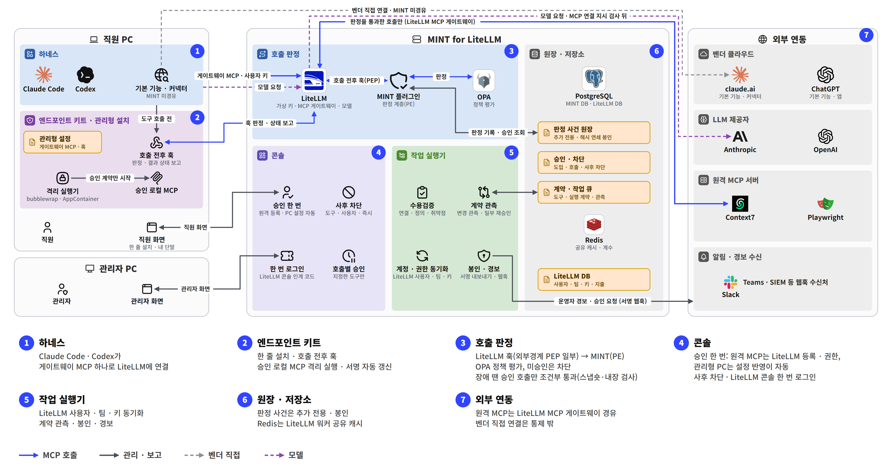
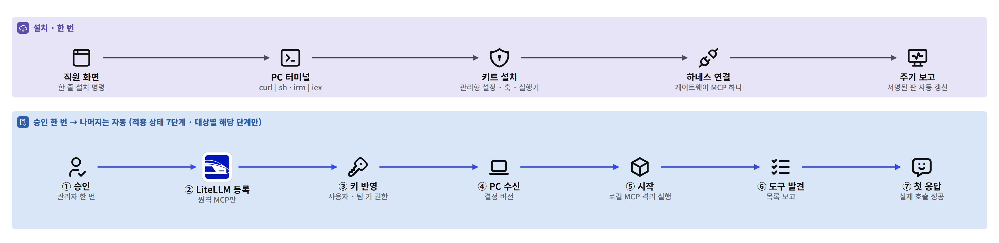
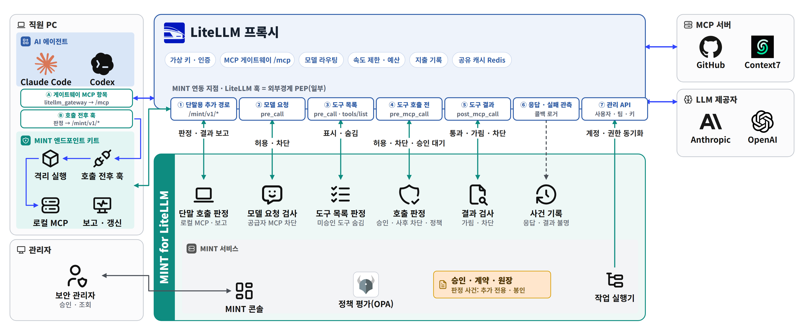

# MINT for LiteLLM

  

MINT for LiteLLM은 LiteLLM 프록시에 붙어 AI 에이전트의 MCP 도구 호출을 승인·판정·기록하는 플러그인입니다.

> [!NOTE]
> MINT는 사전 판정 훅을 지나는 LiteLLM MCP 도구 호출과, 관리형으로 설치한 단말의 호출 전 훅이 보내는 MCP·지원 내장 도구 호출을 판정합니다. 게이트웨이를 거치지 않는 직접 연결, 훅이 없는 하네스, `prompts`·`resources`는 집행 범위 밖이며 `/mcp/proxy` 경로의 판정은 확인되지 않았습니다. 모델 요청에 담긴 외부 MCP 연결 지시는 별도로 검사합니다. 경로별 보장과 한계는 [보장과 한계](docs/보장과-한계.md)에 있습니다.



## 소개

모델 컨텍스트 프로토콜(MCP, Model Context Protocol)을 쓰면 Claude Code·Codex 같은 에이전트가 파일을 고치고, 명령을 실행하고, 외부 서비스를 호출할 수 있습니다. 조직이 이 도구 사용을 관리하려고 하면 보통 다음 문제가 생깁니다.

- 누가 어떤 MCP 서버를 쓰는지 알기 어렵고, 승인하지 않은 서버(섀도우 도구)가 섞입니다.
- 서버를 승인해도 게이트웨이 등록, 키 권한, 직원 PC 설정을 사람이 따로 맞춰야 합니다.
- 호출 하나하나가 누구의 어떤 권한으로 실행됐는지 남지 않습니다.

MINT는 LiteLLM의 인증·전송·자격증명 저장·속도 제한을 그대로 쓰고, 그 위에 도입 승인, 호출별 판정, 판정 기록을 더합니다. 직원은 서버 주소와 목적만 내고, 관리자는 승인을 한 번 누릅니다.

## 특징

- **한 번 승인** - 관리자의 도입 승인 뒤 원격 MCP는 LiteLLM 등록과 권한 반영이, 관리형 PC는 설정 반영이 자동으로 이어집니다.
- **호출마다 판정** - 호출마다 승인 근거와 정책을 판정하고, 계약 관리 대상 서버는 도구·배포 계약의 변경 여부도 확인합니다.
- **결과 검사** - 결과 집행 훅이 있는 보장 등급(A·B)에서는 설정에 따라 MCP 도구 결과를 가리거나 막고 크기 상한을 적용합니다.
- **단말 키트(엔드포인트 키트)** - 관리형으로 설치한 Linux·Windows 단말에서 승인된 로컬 MCP를 격리해 실행하고, 키트는 서명된 판으로 갱신합니다.
- **가용성 우선** - 정책 엔진이나 DB 장애 중에도 승인된 호출은 정해진 조건에서 계속 통과하고, 승인 밖 호출은 막습니다.

## 설치

배포 묶음은 `deploy/`에 있으며 Docker Compose가 있는 Linux 기기에서 실행합니다. 묶음에는 LiteLLM, PostgreSQL, Redis, 정책 엔진(OPA), 작업 실행기, 콘솔이 들어 있습니다.

```sh
cd deploy
cp .env.example .env   # 비밀값은 up이 채웁니다
./mint.sh up           # 이미지 빌드, 마이그레이션, 기동
./mint.sh status       # 상태와 남은 할 일
```

처음 `up`은 LiteLLM이 자기 DB를 준비하느라 몇 분 걸립니다. 설정 항목은 [설정](docs/설정.md)에 있습니다.

## 빠른 시작

**관리자 로그인**

새 설치에는 기본 관리자 계정 `root` / `rootroot`와 `admin1`~`admin3` / `adminadmin`이 있습니다. 기본 비밀번호로 로그인하면 화면 위에 바꾸라는 알림이 뜨며, 바꾼 비밀번호는 재기동·업그레이드 뒤에도 유지됩니다.

콘솔 상단의 「LiteLLM 콘솔」을 누르면 추가 로그인 없이 같은 사용자로 LiteLLM 관리 화면에 들어갑니다. LiteLLM 사용자·팀은 MINT 계정·역할로 자동 동기화되므로 MINT 계정을 따로 만들지 않습니다.

**직원 PC 연결**



직원은 직원 화면의 「내 단말」에서 「설치 명령 만들기」를 누르고, 나온 한 줄을 PC 터미널에 붙여 넣습니다. 이 명령의 설치 코드는 15분 안에 한 번만 쓸 수 있습니다.

```sh
# Linux
curl -fsSL https://<콘솔 주소>/kit/<코드>/install.sh | sh
# Windows PowerShell
irm https://<콘솔 주소>/kit/<코드>/install.ps1 | iex
```

**MCP 서버 신청과 승인**

직원 PC에서 `mint add <MCP 서버 주소>`로 신청하면 목적 한 칸만 묻습니다. 로컬 서버는 `mint add <이름> -- uvx <패키지>==<판본>` 형식으로 신청합니다.

관리자가 콘솔 「도입 신청」에서 승인을 누르면 권한과 관리형 PC 설정의 반영이 자동으로 이어집니다. 신청 화면의 적용 상태는 승인→LiteLLM 등록→키 반영→PC 수신→시작→도구 발견→첫 응답 순으로 진행되며, 로컬 서버의 LiteLLM 등록은 「해당 없음」으로 표시됩니다. 하네스가 기존 도구 목록을 붙잡고 있으면 새 세션에서 확인합니다.

운영 명령은 `./mint.sh cli <명령>`, 판본 올리기는 `./mint.sh upgrade`입니다.

## 제로트러스트 구성요소와의 대응

용어는 「에이전틱 AI 제로트러스트 안내서」(과학기술정보통신부·KISA, 2026) 부록의 용어 정의를 따릅니다. 아래 표는 안내서의 논리 역할에 대한 부분 대응이며, 각 구성요소는 「범위」 안에서만 해당 역할을 합니다.



| 안내서 용어 | MINT 구현 | 범위 |
| --- | --- | --- |
| 외부경계 PEP(Gateway Policy Enforcement Point)의 일부 역할 | LiteLLM MCP 호출 전후 집행 훅(`pre_mcp_call`·`post_mcp_call`) | 기업 경계 밖 MCP 서버로 향하고 해당 훅을 지나는 도구 호출 |
| 내부 PEP(Inline Policy Enforcement Point) | 단말 키트의 호출 전 훅(`/mint/v1/decide`) | 관리형 설치의 하네스가 실행하는 MCP 호출과 지원 내장 도구(셸·파일 쓰기 등) 호출 |
| 입력 PEP(Input Policy Enforcement Point)의 일부 역할 | LiteLLM 도구 결과 검사(가림·차단·크기 상한) | 결과 집행 훅을 지나는 MCP 도구 응답 |
| 정책결정지점(PDP, Policy Decision Point) | 판정 계층과 결정 전달부를 묶은 논리 계층 | 위 PEP가 묻는 호출 |
| 정책 엔진(PE, Policy Engine) | MINT 판정 계층(승인·계약·정책·의무를 합쳐 최종 판정, 정책 평가는 OPA) | 아래 「판정 순서」 |
| 정책 관리자(PA, Policy Administrator)의 일부 역할 | 판정 결과를 훅에 돌려주는 반환부, 작업 실행기의 LiteLLM 서버 등록·키 권한 동기화 | 호출별 결정 전달, 승인·철회에 따른 접근 설정 |
| 정책정보지점(PIP, Policy Information Point) | MINT DB(승인·계약·명부·판정 사건)와 LiteLLM 사용자·팀 정보 | 판정에 쓰는 상태 |
| 인간 개입(HITL, Human-in-the-Loop) | 실행 중 사람이 직접 검토하는 호출별 승인·본인 확인 | 관리자가 해당 의무를 건 도구의 호출 |

도입 승인은 사전 거버넌스이며 실행 중 인간 개입과 구분합니다. 모델 요청 사전 검사(`pre_call`)는 공급자 쪽 MCP 직접 연결 지시처럼 지원하는 형식을 막는 별도 검사입니다.

## 판정 순서

도구 호출 하나는 아래 순서로 판정합니다. 어느 단계에서 막히면 MCP 서버로 전달하지 않습니다.

1. **상태 읽기** - 서버·주체·승인·거부·동의·정책 판본을 한 번의 질의로 같은 시점에 읽습니다.
2. **부정 상태** - 거부, 중지·종료된 서버, 철회·만료된 승인, 마스터 키·익명 호출을 막습니다.
3. **승인 선택** - 도입 승인, 기간 승인, 상시 승인 규칙 중 이 호출에 맞는 근거를 고릅니다.
4. **계약** - 계약 관리 대상 서버에서 도구 계약과 배포 계약이 승인 때와 같은지 확인합니다. 승인 뒤 새로 생긴 도구는 기본 허용합니다.
5. **정책** - 정책 엔진이 활성 정책 번들로 판정합니다. 도구 인자 원문은 정책 엔진에 보내지 않습니다.
6. **의무** - 필수 동의가 없거나 만료·철회됐으면 막습니다. 호출별 승인이나 본인 확인이 필요하면 LiteLLM 경로는 기본 120초 동안 결정을 기다리고, 단말 훅 경로는 승인 대기를 알리고 호출을 멈추므로 승인 뒤 다시 호출합니다.
7. **기록** - 판정 사건을 기록한 뒤 전달합니다.

막힌 호출의 오류 본문 첫 줄은 승인 대기, 정책 차단, 관리자 차단, 일시 오류를 구분해 알립니다.

정책 엔진 장애 때는 앞 단계의 승인·차단 검사를 통과한 호출을 내장 검사로 판정합니다. DB 장애 때는 같은 질의의 마지막 정상 스냅숏이 워커에 있을 때만 판정하고 사건을 로컬 버퍼에 남겼다가 복구 뒤 올리며, 그사이의 새 철회·차단은 복구 전까지 반영되지 않습니다. 스냅숏이 없으면 막습니다.

## 지원 판본

LiteLLM 1.106.6, 1.108.5(LTS)와 Python 3.12 이상을 지원합니다.

기동할 때 설치된 LiteLLM에서 MINT가 쓰는 훅 지점을 확인해 보장 등급(A~D)을 정하고, A가 아니면 빠진 능력을 밝히고 기동하지 않습니다. B·C만 운영자가 명시하면 저하 운용으로 기동하며, D는 기동하지 않습니다.

## 문서

| 문서 | 내용 |
| --- | --- |
| [운영](docs/운영.md) | 운영자가 매일·주기적으로 하는 일과 화면·명령 |
| [설정](docs/설정.md) | 환경 변수, LiteLLM 설정, 정책 엔진, 배포 묶음, 지표 |
| [CLI](docs/CLI.md) | `mint-litellm` 명령, 증빙, 경보와 웹훅 형식 |
| [보장과 한계](docs/보장과-한계.md) | MINT가 보장하는 것과 보장하지 않는 것 |
| [업그레이드](docs/업그레이드.md) | 이전 판본에서 올릴 때의 점검 목록 |
| [개발](docs/개발.md) | 의존성 잠금, 이미지 고정, 통합 시험 |

## 라이선스

MIT
